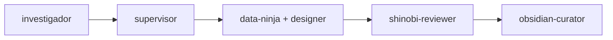

# Tally — Proot de implementación

## Para ejecutar cuando decidas implementar Tally

## Ideas futuras (no implementar aún)

- **Integración Coda → Tally:** Importar JSON de Coda con total de suscripciones del mes y crear gasto único en cuenta elegida (ahorros/crédito). Selector archivos desde Ajustes. Sin backend.
- **5to tab Suscripciones:** Opcional. Mostrar suscripciones importadas con próximo cobro y monto. Icono calendario/repeat.

### Pre-implementación

### Paso 1: investigador
**Rol:** Verificación multi-fuente
- Verificar que no hay cambios en el spec desde Junio 2026
- Investigar edge cases financieros: meses con 28/29/30/31 días, años bisiestos, manejo de múltiples monedas (DOP, USD)
- Confirmar mejores prácticas para alertas de presupuesto en PWA
- Verificar compatibilidad iOS 27+ para Notification API
- **Resultado:** Reporte con hallazgos y riesgos identificados

### Paso 2: supervisor
**Rol:** Arquitectura y orquestación
- Recibir reporte del investigador
- Definir estructura final de archivos y carpetas
- Decidir: ¿misma estructura que Coda o modularización diferente?
- Definir flujo de datos: IndexedDB → UI en tiempo real (descarga inmediata)
- Decidir input de fecha en sheet: por defecto fecha actual (`new Date()`), añadir input de fecha colapsable para antidatar gastos
- Planificar paralelización: qué se puede hacer en simultáneo
- **Resultado:** Plan de implementación final con delegaciones

### Paso 3: data-ninja + designer (paralelo)
**data-ninja** — Datos, APIs, lógica
- IndexedDB: schema de cuentas, gastos, ingresos, categorías, presupuestos
- `js/storage.js`: singleton DB con transacciones atómicas
- `js/app.js`: routing de 4 tabs + FAB + sheet con toggle Gasto|Ingreso
- `js/dashboard.js`: scroll horizontal cuentas, cards resumen, lógica de descuento/suma
- `js/lista.js`: lista filtrable con paginación virtual
- `js/stats.js`: donut SVG, barras categoría con alertas, barras semanales
- `js/settings.js`: export/import JSON, CRUD cuentas y categorías
- `js/notifications.js`: alertas 80%/100%

**designer** — CSS, UI, branding
- `css/style.css` completo con paleta: #0A0A0A, #8B5CF6, glassmorphism
- Logo SVG definitivo: T blanca + pila 3 monedas violeta (versión app icon)
- Animaciones: glassmorphism blur(24px), spring en scroll horizontal, ripple en botones
- Tarjeta crédito #1E1E24 diferenciada visualmente
- Alertas presupuesto: #B91C1C (80%) y #7F1D1D (100%) sin amarillos
- Iconos SVG para todas las categorías predefinidas (8-10)
- Responsive para iPhone + desktop
- `manifest.json` + `sw.js` PWA offline
- `index.html` app shell con safe areas iOS

### Paso 4: shinobi-reviewer
**Rol:** QA completo
- Edge cases: saldo 0, múltiples tarjetas, mes rollover, año bisiesto
- Seguridad: XSS en inputs, escaped strings
- PWA: service worker offline, manifest completo, splash screen
- iOS: viewport, safe areas, touch-action, font-size 16px
- Regresiones: todas las funciones siguen funcionando después de cambios
- **Resultado:** Reporte de bugs con severidad y fixes

### Paso 5: obsidian-curator
**Rol:** Documentación post-implementación
- Actualizar el changelog en `10-Projects/Tally/2026-06-23-tally-design.md`
- Guardar decisiones técnicas importantes en la nota
- Sincronizar con memoria vectorial

## Notas adicionales
- **Validación OpenFoodFacts (offline-first)**: antes de guardar un gasto en IndexDB, intentar fetch a world.openfoodfacts.org. Si falla (timeout/sin señal), guardar el gasto igual con bandera `pendingEnrich: true`. Cuando vuelva la conexión, enriquecer el nombre del producto automáticamente.
- **Fecha seleccionable en sheet**: por defecto usa `new Date()`. Añadir input de fecha colapsable/minimalista para antidatar gastos (poner fecha de ayer o anterior). No romper diseño limpio.
- **Categoría "Regalo"**: en modo Gasto, NO incluirla. En modo Ingreso, SÍ incluirla (recibir un regalo financiero es un ingreso).
- **Sin flechas en input monto**: ocultar spinners nativos del `input[type=number]` con `-webkit-appearance:none` y `-moz-appearance:textfield`.

## Recordatorios clave
- Cuentas: múltiples, creadas por usuario, scroll horizontal en dashboard
- Toggle Gasto|Ingreso en el mismo sheet del FAB (un solo punto de entrada)
- Alertas 80% (#B91C1C) y 100% (#7F1D1D) en barras de categoría — sin amarillos
- Presupuestos mensuales se resetean, saldos de cuenta NO se resetean
- Logo: T blanca horizontal + pila 3 monedas violeta (versión app icon simplificada)
- Deploy en Cloudflare Pages con dominio nuevo (no reusar coda-3j8.pages.dev)
- Stack: vanilla HTML/CSS/JS, IndexedDB, Notification API, SW, CF Pages ($0)
